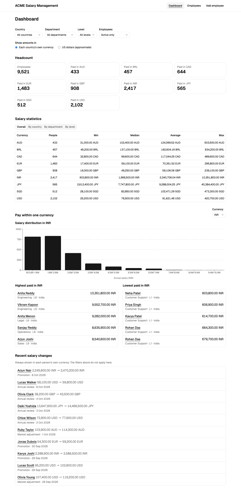
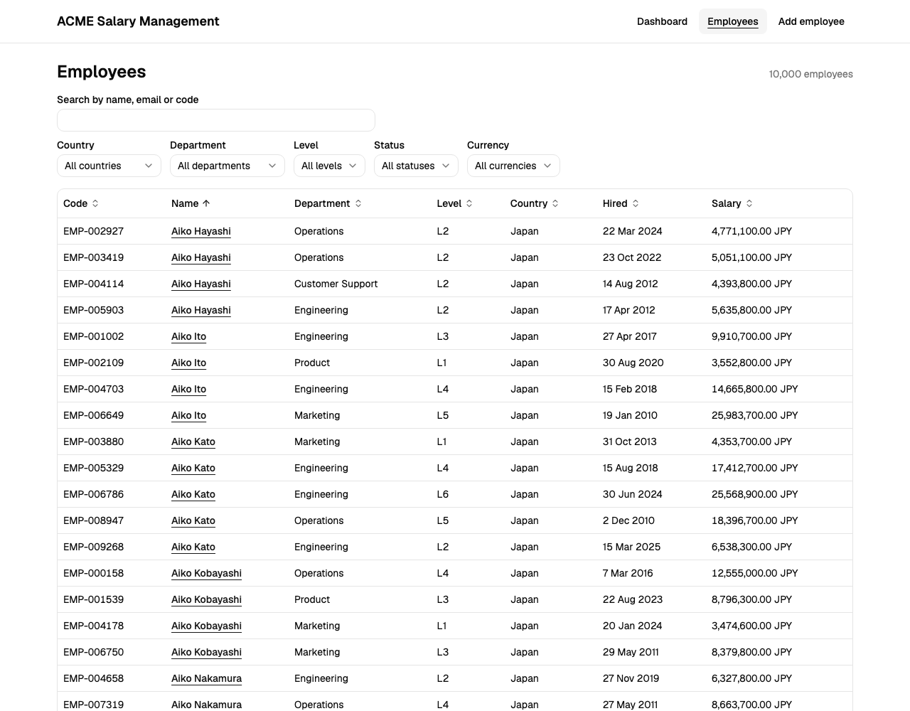
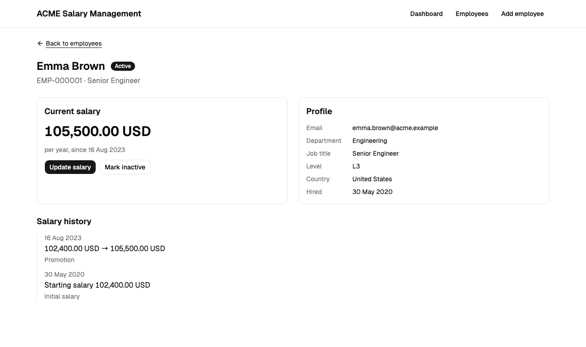
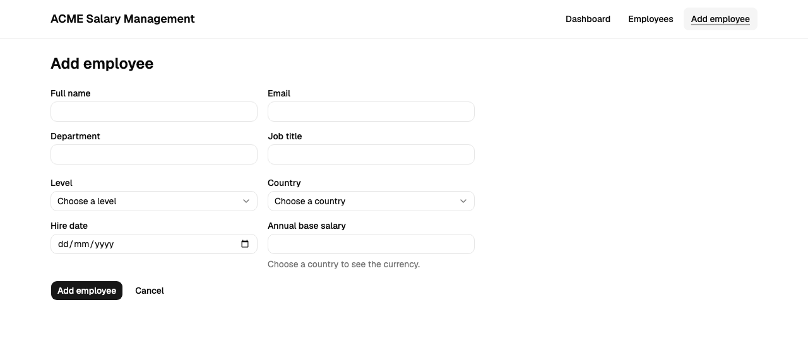

# ACME Salary Management

A web app for an HR manager to manage the salaries of 10,000 employees across 10 countries, and to answer
"how does the organisation pay people?" without spreadsheets.

> **Live app:** _to be added after deployment_ · **Demo video:** _to be added_ · The free server may take up to a minute to wake up on the first visit.



## What it does

- **Find people:** search by name, email or code. Filter by country, department, level, status and currency. Sort and page through 10,000 employees. The address bar holds your filters, so a link can be shared.
- **See and change pay:** each employee has a profile and a salary history. A salary change needs a reason, and every change is kept.
- **Add people:** a form that sets the currency from the country.
- **Understand pay:** headcount, minimum, median, average and maximum salary by country, department and level. A salary histogram, the highest and lowest paid, and the latest changes.
- **Never mixes currencies by accident.** Statistics are grouped by currency. An optional "US dollars" view uses fixed, clearly labelled, illustrative exchange rates.

| Employees | Employee | Add employee |
| --- | --- | --- |
|  |  |  |

## Documentation

| Read this | To learn |
| --- | --- |
| [Requirements](docs/REQUIREMENTS.md) | The goal, what is in scope, and what was left out and why |
| [User stories](docs/USER_STORIES.md) | What the HR manager can do, with acceptance criteria |
| [Design](docs/DESIGN.md) and [Low-level design](docs/LLD.md) | Diagrams, data model, rules, how each part works |
| [API](docs/API.md) | Every endpoint, with examples |
| [Decisions](docs/DECISIONS.md) | Why PostgreSQL, why no login, the currency policy, and more |
| [Performance](docs/PERFORMANCE.md) | Measured response times and the index review |
| [Browser checks](docs/qa/README.md) | Accessibility, keyboard and screenshot checks |
| [Task plan](docs/TASKS_PLAN.md) | The step-by-step plan, ticked off as it was built |
| [AI usage](AI_USAGE.md) | How AI tools were used |

## Technology

React, TypeScript, Vite, Tailwind CSS, shadcn/ui and Recharts in the browser. Node, Express and Prisma on the server.
PostgreSQL for data. Vitest, Testing Library and Supertest for tests. Free hosting: Render and Neon.

## Layout

| Path | Purpose |
| --- | --- |
| `api/` | Express API, Prisma schema and migrations, seed script |
| `web/` | React app |
| `shared/` | Types and reference data used by both sides |
| `docs/` | Requirements, design, decisions, performance notes, screenshots |

## Run it on your computer

```bash
cp .env.example .env
docker compose up -d         # local PostgreSQL (or use any PostgreSQL 14+ you already run)
npm install
npm run db:generate -w api   # generate the Prisma client
npm run db:migrate -w api    # create the tables in salary_management
npm run seed -w api          # add 10,000 fictional employees (about 5 seconds)

npm run dev -w api           # the API, on http://localhost:4000   (first terminal)
npm run dev -w web           # the web app, on http://localhost:5173   (second terminal)
```

Open http://localhost:5173. While developing, the web app forwards `/api` calls to the API on port 4000.

**Using your own PostgreSQL instead of Docker.** Create the role and two databases once:

```sql
CREATE ROLE acme LOGIN PASSWORD 'acme' CREATEDB;
CREATE DATABASE salary_management OWNER acme;
CREATE DATABASE salary_management_test OWNER acme;   -- the tests wipe this one
```

The tests apply migrations to `salary_management_test` themselves. They refuse to run against any database whose name does not end in `_test`.

## Commands

| Command | What it does |
| --- | --- |
| `npm run check` | Everything CI runs: lint, format check, type-check and all tests |
| `npm test` | Tests in every workspace |
| `npm run test:coverage` | Tests with a coverage summary |
| `npm run lint` / `npm run lint:fix` | ESLint (strict, type-aware) |
| `npm run format` / `npm run format:check` | Prettier |
| `npm run typecheck` | `tsc --noEmit` in every workspace (strict mode) |
| `npm run build` | Builds the web app into `web/dist` |
| `npm run seed -w api` | Replace all data with 10,000 fictional employees. Safe to run again. Refuses to run on a remote database unless `SEED_CONFIRM=yes` |
| `npm run db:generate -w api`, `db:migrate`, `db:deploy` | Generate the Prisma client, create a migration, apply migrations |

A pre-commit hook (Husky + lint-staged) lints and formats staged files. It is enabled by `npm install`.

## Tests

About 1,000 automated tests, all fast and deterministic: rules and money maths, every API endpoint against a real
PostgreSQL test database, and the screens (what they ask the server for, what they show, validation, errors).
Accessibility rules are also checked inside the tests. See [docs/qa](docs/qa/README.md) for the browser checks
(colour contrast, keyboard use).

## Branching and commits

- `main` is always deployable. Work happens on short-lived branches (`feat/`, `fix/`, `chore/`, `docs/`, `test/`) merged with `--no-ff`.
- Conventional Commits. Behaviour changes start with a failing test commit, then the code commit.
