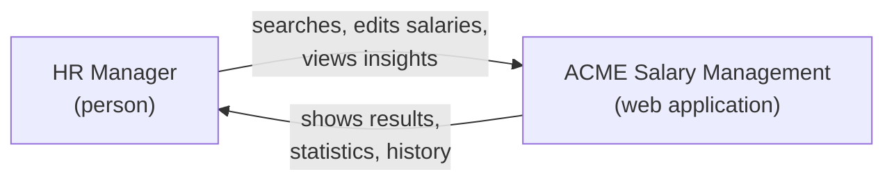
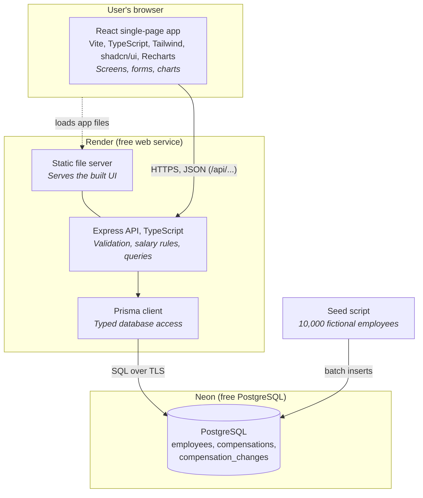
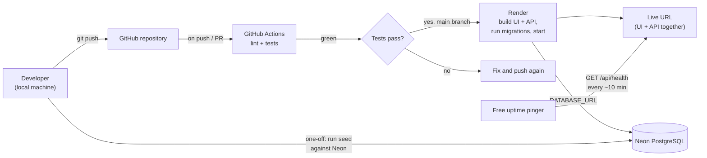
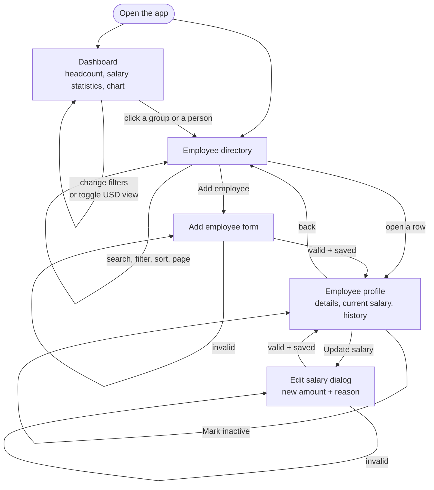
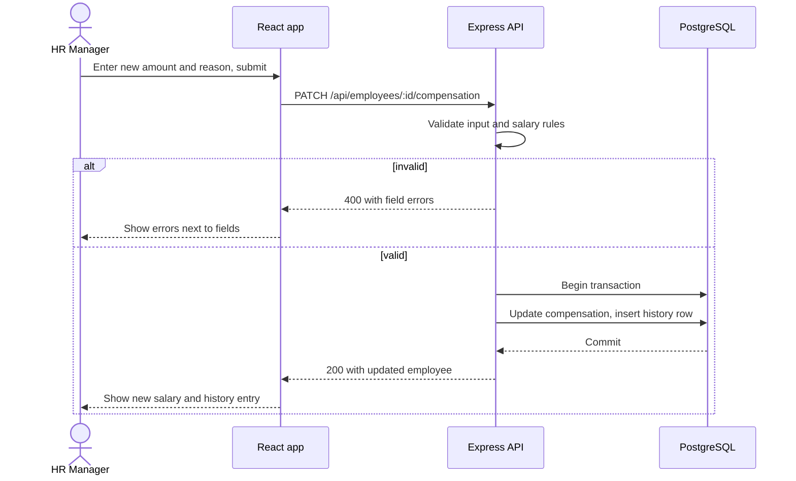

# High-Level Design (HLD)

This document explains the system from the outside in: who uses it, what it is made of, how it is deployed, and how a user moves through it. Detailed design (tables, API, class structure) is in the low-level design, added in Phase 3.

Related: [Requirements](REQUIREMENTS.md) · [User stories](USER_STORIES.md) · [Decisions](DECISIONS.md)

## 1. System context

Who and what touches the system. There is one human user and no external systems.

- The HR manager is the only user. There is no login (decision 005).
- No payroll, HRIS or exchange-rate service is connected (see Requirements, "Deliberately left out").

## 2. Containers

The runnable parts and what each one is responsible for.

| Container | Responsibility | Does not do |
| --- | --- | --- |
| React app | Show data, collect input, draw charts | Business rules, large calculations |
| Express API | Validate input, apply salary rules, build queries, shape responses | Render screens |
| PostgreSQL | Store data, enforce constraints, run filtering, sorting, paging and statistics | Business workflow |
| Seed script | Create repeatable fictional data | Run in production requests |

**Key rule:** the browser never receives all 10,000 rows. Searching, sorting, paging and statistics run in the database.

## 3. Deployment

How code gets from GitHub to a live URL. Every service is on a free tier (decision 004).

**Environments**

| | Local | Production |
| --- | --- | --- |
| Database | Docker PostgreSQL | Neon |
| API + UI | `npm run dev` (two dev servers) | One Render service |
| Config | `.env` (not committed) | Render environment variables |
| Data | Seeded locally | Seeded once from the developer machine |

**Free-tier behaviour:** Render sleeps the API after about 15 minutes idle, so the first request can take up to a minute. The pinger and a README note reduce the impact.

## 4. Main user flow

What the HR manager does, and where each step is served from.

**Where it is served from**

| Step | API call | Story |
| --- | --- | --- |
| Directory list, search, filter, sort | `GET /api/employees` | US-01 to US-04 |
| Filter dropdown options | `GET /api/meta/filters` | US-03 |
| Profile | `GET /api/employees/:id` | US-05 |
| Add employee | `POST /api/employees` | US-06 |
| Update salary | `PATCH /api/employees/:id/compensation` | US-07 |
| Salary history | `GET /api/employees/:id/compensation-history` | US-08 |
| Dashboard | `GET /api/analytics/...` | US-10 to US-14 |

### Request path for one action (update a salary)

## 5. Technology choices and trade-offs

| Area | Choice | Why | Trade-off | Alternative not chosen |
| --- | --- | --- | --- | --- |
| Language | TypeScript (UI and API) | One language, shared types, matches the role | Build step needed | Plain JavaScript (less safe) |
| Database | PostgreSQL | Exact `NUMERIC` money, median and percentile functions, free persistent hosting (Neon) | Needs Docker locally | SQLite (no decimal type, weak aggregates) |
| ORM | Prisma | Typed queries, migrations, simple seed workflow | Complex statistics need raw SQL | Drizzle, Knex (less tooling out of the box) |
| API | Express | Small, well known, easy to test with Supertest | No built-in structure, so we add modules ourselves | NestJS (more setup than this scope needs) |
| Validation | Zod | One schema for runtime checks and types, shared by UI and API | Another library to learn | Hand-written checks |
| UI build | Vite + React | Fast dev server, simple build | Single-page app, no server rendering | Next.js (more than needed, no SEO need) |
| Server state | TanStack Query | Caching, loading and error states, easy paging | Extra dependency | Manual fetch and state |
| Styling | Tailwind CSS + shadcn/ui | Accessible components, quick consistent look, components live in our repo | Utility classes are verbose | Material UI (heavier), plain CSS (slower) |
| Charts | Recharts | React-native charts, simple API | Fine for these chart sizes only | D3 (more work), Chart.js (not React-first) |
| Tests | Vitest + Supertest | Fast, TypeScript native, one runner for UI and API | Younger than Jest | Jest (slower setup with TypeScript) |
| Hosting | Render + Neon | Free, no card needed, persistent database | API sleeps when idle | Railway, Fly.io (no lasting free tier) |
| Packaging | npm workspaces | One install, shared package | No task caching | Nx, Turborepo (overkill) |

## 6. Non-functional requirements

| Area | Target | How we meet it | How we check it |
| --- | --- | --- | --- |
| **Performance** | List and statistics responses under 300 ms with 10,000 rows | Database-side filtering, sorting, paging and statistics. Indexes on country, department, level, code and name. Page size capped at 100. | `EXPLAIN ANALYZE` before and after indexes, recorded in `docs/PERFORMANCE.md` |
| **Correctness** | No rounding errors in money, no mixed-currency totals | `NUMERIC(14,2)` in the database, decimal handling in code (never floating point), grouping by currency | Unit tests on small hand-checked datasets |
| **Data integrity** | Salary change and its history are never out of step | One database transaction, unique constraints on code and email, foreign keys | Tests that force a failure and check rollback |
| **Security** | Safe for an open, fictional-data demo | Validate every input at the API edge. Parameterised queries (Prisma). Sort columns from an allow-list. CORS limited to the app origin. No secrets in the repository. Security headers. `npm audit` before release. Error messages never leak internals. | Tests for invalid input and unknown sort columns, dependency audit |
| **Privacy** | No real personal data | Seed uses generated names and emails only | Review of seed script and demo |
| **Reliability** | Clear failure behaviour | Consistent error format. `/api/health` checks database connectivity. Graceful handling of a sleeping or slow API in the UI. | Health and error-handler tests |
| **Accessibility** | Usable with keyboard, readable | Labelled form fields, visible focus, sufficient contrast, semantic table markup, error text tied to fields | Manual keyboard pass and a checklist |
| **Maintainability** | Easy for a newcomer to read | Feature modules, small functions, strict TypeScript, lint and format on CI, docs beside code | CI green, code review |
| **Testability** | Fast and deterministic | Pure domain logic separate from I/O, seeded random data, isolated test database | Suite runs in seconds locally |
| **Observability** | Enough to debug a demo | Structured request logs, request ID in error responses | Manual check |

## 7. What a newcomer should take from this
1. One user, one web app, one database.
2. The React app only displays and collects. The Express API holds all rules. PostgreSQL does the heavy filtering and statistics.
3. Money is exact and currencies are never mixed by accident.
4. Everything runs on free tiers, deployed from GitHub, with one URL.
