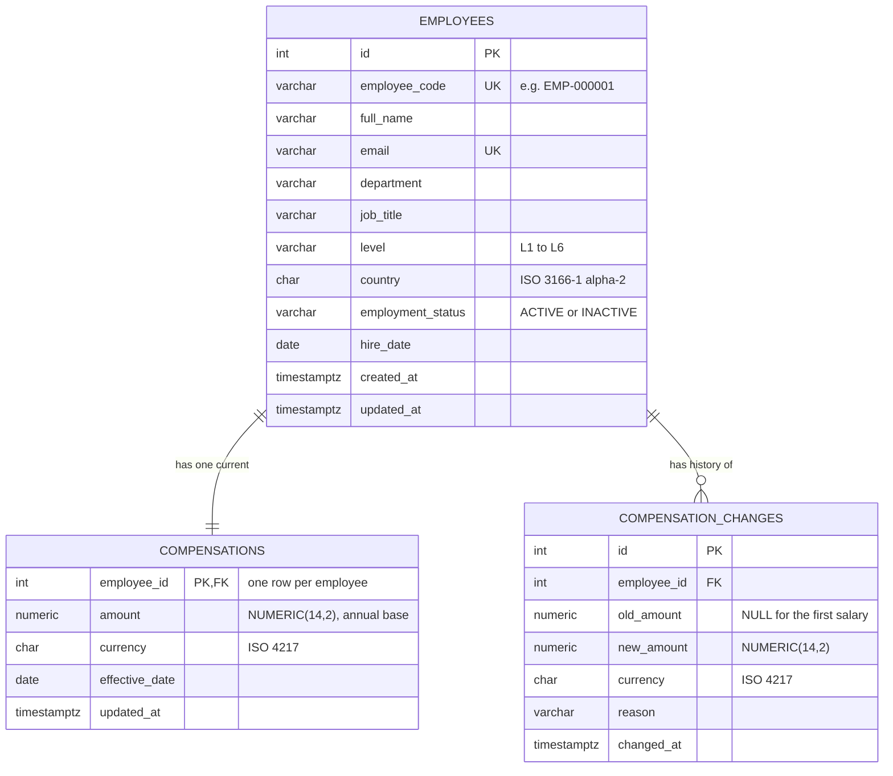
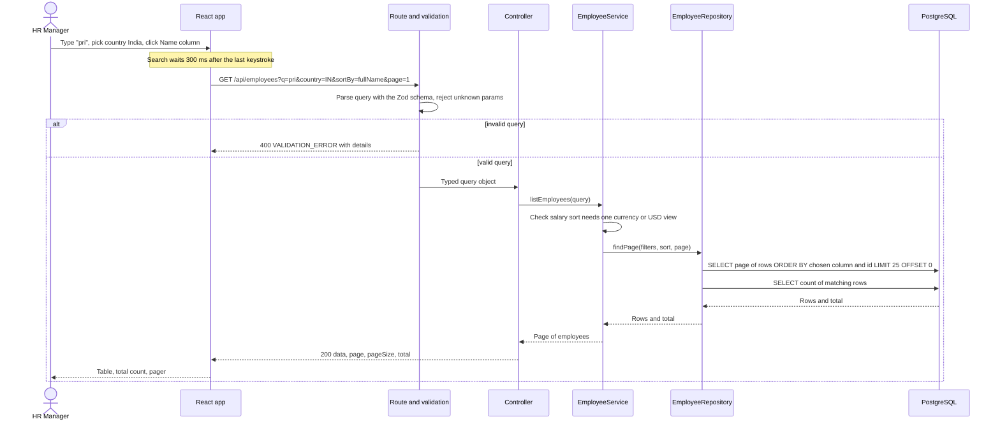
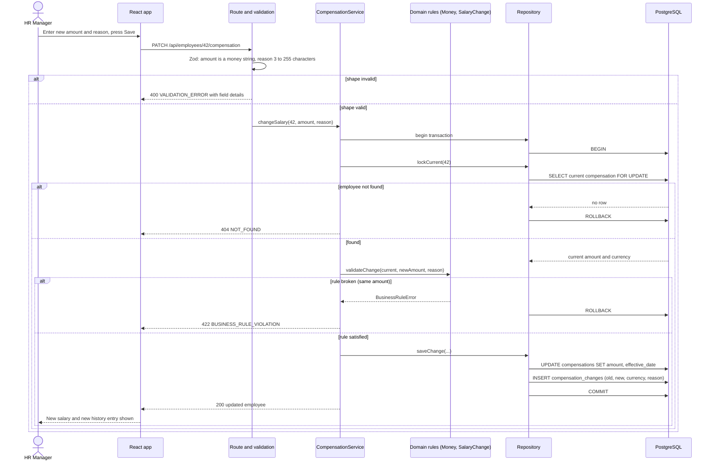
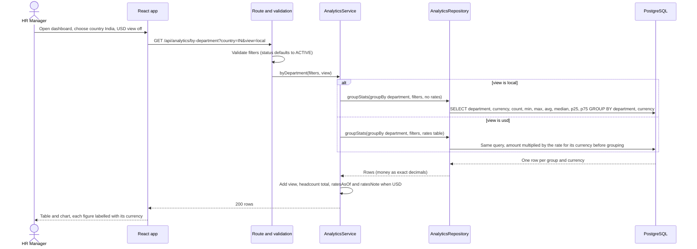
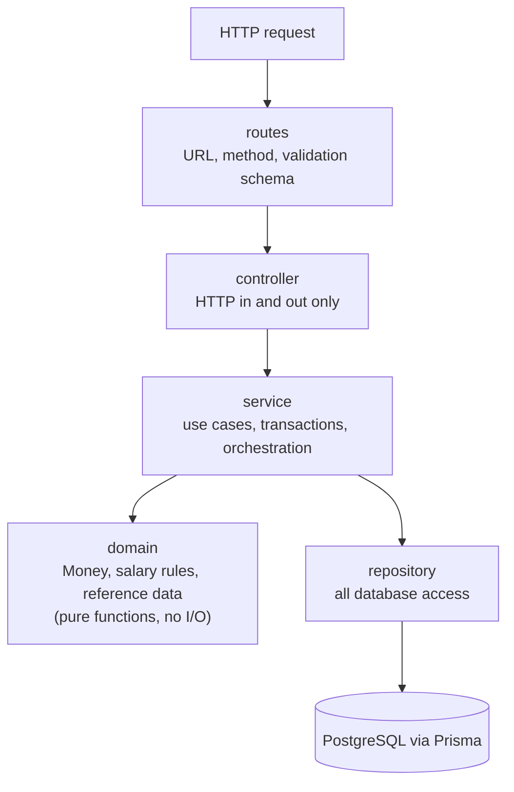
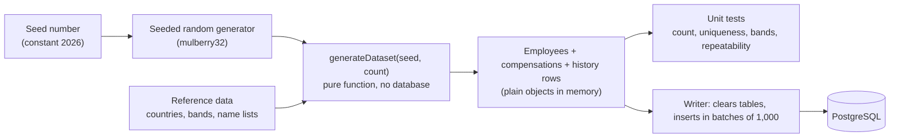
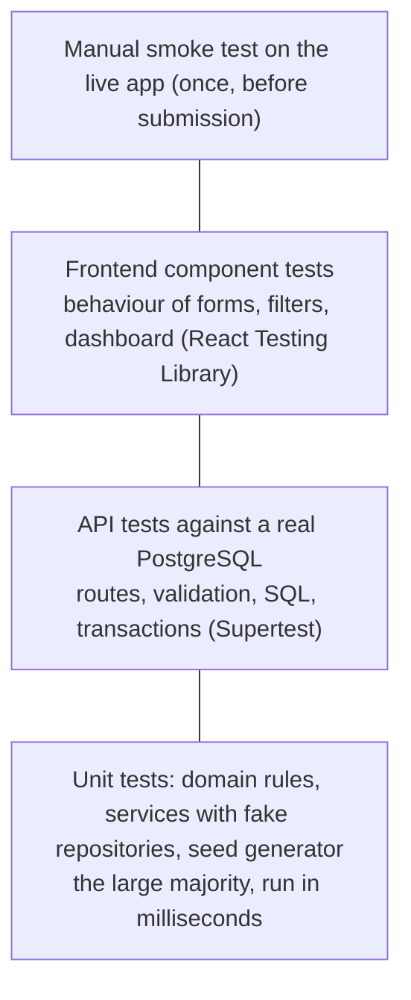

# Low-Level Design (LLD)

Detail below the [high-level design](DESIGN.md). Sections 1 and 3 to 8 are in this file. Section 2 (API contract) is in [API.md](API.md).

| Section | Status |
| --- | --- |
| 1. Data model | Done (task 3.1) |
| 2. API contract | Done: see [API.md](API.md) (task 3.2) |
| 3. Sequence diagrams | Done (task 3.3) |
| 4. Backend modules | Done (task 3.4) |
| 5. Domain rules | Done (task 3.5) |
| 6. Frontend design | Done (task 3.6) |
| 7. Seed design | Done (task 3.7) |
| 8. Test strategy | Done (task 3.8) |

---

## 1. Data model

### 1.1 Entity-relationship diagram



**Not in the database:** the country-to-currency map and the USD rates live in code (section 1.5).

### 1.2 Table definitions

#### `employees`
Who the person is. Contains no pay data.

| Column | Type | Null | Rule | Notes |
| --- | --- | --- | --- | --- |
| `id` | `INTEGER` identity | no | Primary key | Internal id used in URLs and joins |
| `employee_code` | `VARCHAR(20)` | no | Unique | Human-friendly code, for example `EMP-000001` |
| `full_name` | `VARCHAR(120)` | no | Not blank | Searchable |
| `email` | `VARCHAR(160)` | no | Unique, stored lower-case | Searchable |
| `department` | `VARCHAR(60)` | no | Not blank | For example Engineering, Sales |
| `job_title` | `VARCHAR(80)` | no | Not blank | |
| `level` | `VARCHAR(2)` | no | `CHECK (level IN ('L1','L2','L3','L4','L5','L6'))` | Sorts correctly as text |
| `country` | `CHAR(2)` | no | `CHECK (country ~ '^[A-Z]{2}$')` | ISO 3166-1 alpha-2, for example `IN`, `US` |
| `employment_status` | `VARCHAR(10)` | no | `CHECK (IN ('ACTIVE','INACTIVE'))`, default `ACTIVE` | Employees are deactivated, never deleted |
| `hire_date` | `DATE` | no | Not in the future (checked in the application) | A `CHECK` on `CURRENT_DATE` is avoided because it can fail when a backup is restored later |
| `created_at` | `TIMESTAMPTZ` | no | Default `now()` | |
| `updated_at` | `TIMESTAMPTZ` | no | Default `now()` | Set by the application on each update |

#### `compensations`
The current salary. Exactly one row per employee.

| Column | Type | Null | Rule | Notes |
| --- | --- | --- | --- | --- |
| `employee_id` | `INTEGER` | no | Primary key and foreign key to `employees(id)`, `ON DELETE RESTRICT` | The primary key guarantees one row per employee |
| `amount` | `NUMERIC(14,2)` | no | `CHECK (amount > 0)` | Annual base salary in local currency. Exact, never floating point |
| `currency` | `CHAR(3)` | no | `CHECK (currency ~ '^[A-Z]{3}$')` | Must match the employee's country (enforced in code) |
| `effective_date` | `DATE` | no | | Date the current amount took effect |
| `updated_at` | `TIMESTAMPTZ` | no | Default `now()` | |

#### `compensation_changes`
Append-only history. One row for the first salary and one row per later change.

| Column | Type | Null | Rule | Notes |
| --- | --- | --- | --- | --- |
| `id` | `INTEGER` identity | no | Primary key | |
| `employee_id` | `INTEGER` | no | Foreign key to `employees(id)`, `ON DELETE RESTRICT` | |
| `old_amount` | `NUMERIC(14,2)` | **yes** | `CHECK (old_amount IS NULL OR old_amount > 0)` | `NULL` marks the starting salary (US-08 AC3) |
| `new_amount` | `NUMERIC(14,2)` | no | `CHECK (new_amount > 0)` | |
| `currency` | `CHAR(3)` | no | Format check as above | Stored on the row so history stays correct even if rules change |
| `reason` | `VARCHAR(255)` | no | Not blank. The first entry uses `Initial salary` | |
| `changed_at` | `TIMESTAMPTZ` | no | Default `now()` | |
| | | | `CHECK (old_amount IS NULL OR old_amount <> new_amount)` | A change must change something |

History rows are never updated or deleted. The application has no code path that does so (US-08 AC4).

### 1.3 Design choices

| Choice | Why | Alternative rejected |
| --- | --- | --- |
| Separate `compensations` table (1:1) | Keeps identity and pay apart, so pay queries and pay changes touch a small table. Leaves room for more pay fields later. | Salary columns inside `employees` (simpler, but mixes concerns). The join cost on 10,000 rows is negligible. |
| Keep `currency` on both `compensations` and `compensation_changes` | History must stay true even if the current rule or rate changes | Derive from country every time (history could silently change) |
| `NUMERIC(14,2)` | Exact decimals. Up to 999,999,999,999.99, enough for any currency, including those with large values such as JPY or IDR. | `FLOAT` (rounding errors), integer cents (the minor unit differs by currency) |
| Text `level` (`L1` to `L6`) with a `CHECK` | Simple, readable in the UI, no extra table | Lookup table (more joins for six fixed values) |
| `department`, `job_title` as plain text | Free to grow, and the filter list comes from `SELECT DISTINCT` | Lookup tables (extra CRUD screens we do not need) |
| `ON DELETE RESTRICT` everywhere | Pay history must not be lost by accident | `CASCADE` |
| Internal `INTEGER` id plus public `employee_code` | Stable joins, readable code for HR. A 4-byte integer holds over 2 billion rows, far more than needed, and Prisma returns it as a plain JSON number (a `BIGINT` would arrive as a JavaScript `bigint`, which JSON cannot carry). | `BIGINT` (needs conversion everywhere), UUID (larger indexes, no benefit here) |
| Status as `ACTIVE`/`INACTIVE` text with a `CHECK` | Easy to read and filter | Boolean (cannot grow to more statuses such as ON_LEAVE) |
| USD rates in code, not a table | Fixed, dated, reviewed in a pull request, no admin screen needed | `fx_rates` table (needs seeding and an editor for no real gain) |

### 1.4 Indexes

Each index exists because a named query needs it.

| Index | Columns | Used by |
| --- | --- | --- |
| `employees_pkey` | `id` | Profile lookup, joins |
| `employees_employee_code_key` (unique) | `employee_code` | Search by exact code, duplicate protection |
| `employees_email_key` (unique) | `email` | Duplicate protection, search by email |
| `idx_employees_country` | `country` | Country filter, statistics by country |
| `idx_employees_department` | `department` | Department filter, statistics |
| `idx_employees_level` | `level` | Level filter, statistics |
| `idx_employees_country_department` | `country, department` | The most common combined filter and grouping |
| `idx_employees_status` | `employment_status` | Active/inactive filter and default "active only" |
| `idx_employees_hire_date` | `hire_date` | Sort by hire date |
| `idx_employees_full_name_trgm` (GIN, `pg_trgm`) | `full_name gin_trgm_ops` | Case-insensitive "contains" search on name |
| `idx_employees_email_trgm` (GIN, `pg_trgm`) | `email gin_trgm_ops` | "Contains" search on email |
| `compensations_pkey` | `employee_id` | Join from employees |
| `idx_compensations_currency_amount` | `currency, amount` | Statistics per currency, sort by salary, top and bottom paid |
| `idx_changes_employee_changed_at` | `employee_id, changed_at DESC` | History for one employee, newest first |
| `idx_changes_changed_at` | `changed_at DESC` | "Recent changes" on the dashboard |

**Notes**
- A plain index cannot speed up `ILIKE '%text%'`. The trigram (`pg_trgm`) indexes can. Prisma cannot express them, so they go in a hand-written SQL migration that also runs `CREATE EXTENSION IF NOT EXISTS pg_trgm`. Neon supports this extension.
- Every list query ends with `ORDER BY <chosen column>, id`. The `id` tie-breaker keeps paging stable (US-04 AC4).
- We use offset paging. At 10,000 rows with a 100-row cap it is fast enough and simple. Keyset paging is a noted future improvement.
- Index choices are checked with `EXPLAIN ANALYZE` in Phase 5G and the results go in `docs/PERFORMANCE.md`. An index that shows no benefit is removed.

### 1.5 Reference data kept in code

Lives in `shared/src/reference.ts` so the API and the UI use the same values. Not in the database.

**Country to currency** (one currency per country, used to set and check the currency):

| Country | Code | Currency |
| --- | --- | --- |
| India | `IN` | `INR` |
| United States | `US` | `USD` |
| United Kingdom | `GB` | `GBP` |
| Germany | `DE` | `EUR` |
| France | `FR` | `EUR` |
| Japan | `JP` | `JPY` |
| Australia | `AU` | `AUD` |
| Canada | `CA` | `CAD` |
| Singapore | `SG` | `SGD` |
| Brazil | `BR` | `BRL` |

Ten countries, with nine currencies because Germany and France share the euro. Adding a country means adding one line.

**USD rates** (decision 007). Fixed and illustrative, shown in the UI with the date:

```ts
export const USD_RATES_AS_OF = '2026-01-01';          // shown in the UI
export const USD_PER_UNIT = {                          // 1 unit of currency = x USD
  USD: 1, EUR: 1.08, GBP: 1.27, INR: 0.012, JPY: 0.0067,
  AUD: 0.66, CAD: 0.74, SGD: 0.74, BRL: 0.20,
} as const;
```

The numbers are placeholders chosen to look reasonable. They are not market data, and the UI says so (US-13 AC3).

### 1.6 Data rules and where each is enforced

Defence in depth: the application rejects bad data with a friendly message, and the database refuses it anyway.

| Rule | Application (friendly error) | Database (last line of defence) |
| --- | --- | --- |
| Salary greater than zero | Zod schema | `CHECK (amount > 0)` |
| At most two decimals | Zod schema and `Money` type | `NUMERIC(14,2)` |
| Currency matches country | Domain rule | Not enforced (needs the map) |
| New amount differs from old | Domain rule | `CHECK (old_amount <> new_amount)` |
| Reason required | Zod schema | `NOT NULL` |
| Unique code and email | Pre-check, then catch the unique-violation error as 409 | Unique indexes |
| Hire date not in the future | Zod schema | Not enforced (the date changes daily, so a `CHECK` is unsafe) |
| Valid level, status, country format | Zod schema | `CHECK` constraints |
| Update salary and write history together | One transaction | Transaction |
| History never edited or deleted | No such code path | `ON DELETE RESTRICT` (no update trigger, kept simple) |

### 1.7 Example data

`employees`

| id | employee_code | full_name | email | department | job_title | level | country | status | hire_date |
| --- | --- | --- | --- | --- | --- | --- | --- | --- | --- |
| 1 | EMP-000001 | Asha Rao | asha.rao@acme.example | Engineering | Software Engineer | L3 | IN | ACTIVE | 2021-04-12 |
| 2 | EMP-000002 | Liam Carter | liam.carter@acme.example | Sales | Account Executive | L4 | US | ACTIVE | 2019-09-02 |

`compensations`

| employee_id | amount | currency | effective_date |
| --- | --- | --- | --- |
| 1 | 2400000.00 | INR | 2025-04-01 |
| 2 | 95000.00 | USD | 2024-01-15 |

`compensation_changes` (history for employee 1)

| id | employee_id | old_amount | new_amount | currency | reason | changed_at |
| --- | --- | --- | --- | --- | --- | --- |
| 1 | 1 | NULL | 2000000.00 | INR | Initial salary | 2021-04-12 |
| 2 | 1 | 2000000.00 | 2400000.00 | INR | Annual review 2025 | 2025-04-01 |

All names and emails are fictional, and the `.example` domain never receives mail.

### 1.8 How the model serves the main questions

| Question from the HR manager | Query shape |
| --- | --- |
| "Find Priya in India" | `employees` filtered by `country`, trigram search on `full_name`, joined to `compensations` |
| "Median salary by department in INR" | `compensations` joined to `employees`, `WHERE currency = 'INR'`, `GROUP BY department`, `percentile_cont(0.5)` |
| "Headcount per country" | `employees` `GROUP BY country` with a status filter |
| "How did this person's pay change?" | `compensation_changes` for one `employee_id`, newest first |
| "What changed recently?" | `compensation_changes` `ORDER BY changed_at DESC LIMIT 10` |
| "Top 10 paid in USD" | `compensations` `WHERE currency = 'USD'` `ORDER BY amount DESC LIMIT 10` |

---

## 3. Sequence diagrams

Three flows, each showing the layers from [section 4](#4-backend-module-design). The same names are used in code: `routes`, `controller`, `service`, `repository`.

### 3.1 List employees with search, filters, sort and paging (US-01 to US-04)



Notes
- The sort column comes from an allow-list that maps API names (such as `salary`) to real columns. The raw text from the URL never reaches SQL.
- The page query and the count query run in parallel.
- Searching uses the trigram indexes from section 1.4.

### 3.2 Update a salary, with its history written in one transaction (US-07, US-08)



Notes
- `FOR UPDATE` locks the row, so two edits at once cannot both start from the same old amount and corrupt the history.
- If either write fails, the transaction rolls back and neither is saved (US-07 AC4). A test forces the second write to fail and checks the first was undone.
- The "now" used for the effective date comes from an injected clock, so tests are deterministic.

### 3.3 Analytics query (US-10 to US-14)



Notes
- All grouping, counting and statistics run in the database. The API only shapes the result.
- The query uses the safe, parameterised raw SQL form of Prisma, because Prisma's query builder cannot compute medians.
- The exact way each statistic is calculated is in section 5.3.

---

## 4. Backend module design

### 4.1 Layers



Dependencies point **downwards only**. A layer never imports from a layer above it.

### 4.2 What each layer may and may not do

| Layer | Does | Must not | Tested by |
| --- | --- | --- | --- |
| **routes** | Declare URL and method. Attach the Zod schema that parses and checks params, query and body. Reject unknown query parameters. | Contain logic or touch the database | HTTP tests |
| **controller** | Take validated input, call one service method, set the HTTP status and response shape | Contain business rules, build SQL, catch domain errors (the error middleware does) | HTTP tests |
| **service** | Run one use case. Apply domain rules. Open and close transactions. Decide which repository calls to make. Translate "not found" into a typed error. | Know about HTTP (no `req`, `res`, status codes). Write SQL. | Unit tests with a fake repository |
| **domain** | Hold pure business rules: `Money`, salary change validation, country-currency check, currency conversion, reference data | Import Express, Prisma, `Date.now()` or random. Do any I/O. | Unit tests (fast, no mocks) |
| **repository** | Run Prisma and raw SQL. Map database rows to plain objects. Map the unique-violation database error to a typed `DuplicateError`. | Contain business rules or decide status codes | Database tests (real PostgreSQL) |
| **middleware** | Request ID, error handler, 404 handler, security headers, CORS | Contain feature logic | HTTP tests |

### 4.3 Modules and files

Each feature folder follows the same pattern, so a newcomer knows where to look.

```
api/src/
├── app.ts                         create the Express app (no listen)
├── server.ts                      read config, connect, listen
├── config/env.ts                  Zod-checked environment variables
├── middleware/
│   ├── requestId.ts
│   ├── errorHandler.ts            maps typed errors to the standard error body
│   └── notFound.ts
├── errors/                        AppError, ValidationError, NotFoundError,
│                                  ConflictError, BusinessRuleError
├── domain/
│   ├── money.ts                   Money value object (exact decimals)
│   ├── salaryChange.ts            validateSalaryChange(...)
│   ├── currency.ts                country-currency check, USD conversion
│   └── clock.ts                   Clock interface, systemClock
├── modules/
│   ├── employees/
│   │   ├── employee.routes.ts
│   │   ├── employee.schema.ts     Zod schemas (also exported through shared)
│   │   ├── employee.controller.ts
│   │   ├── employee.service.ts
│   │   ├── employee.repository.ts
│   │   └── employee.mapper.ts     database row to API object
│   ├── compensation/              salary change and history (same five files)
│   ├── analytics/                 same pattern, repository uses raw SQL
│   ├── meta/                      filter options
│   └── health/
└── tests/                         HTTP and database tests, test helpers, builders
```

### 4.4 Rules for errors, transactions and data

| Topic | Rule |
| --- | --- |
| Errors | Code throws typed errors (`ValidationError`, `NotFoundError`, `ConflictError`, `BusinessRuleError`). Only `errorHandler` turns them into HTTP responses. Unknown errors become `500 INTERNAL_ERROR` and are logged. |
| Transactions | Owned by the **service**. It asks the repository for a transaction scope and passes it to every call inside. Repositories never start their own. |
| Dependency injection | Services receive their repository (and the clock) as constructor arguments. Tests pass fakes. `app.ts` wires the real ones. |
| Validation | Shape and format at the edge (Zod). Business rules in the domain. Constraints in the database as a last line of defence. |
| Queries | Prisma query builder for simple reads and writes. Raw SQL only for statistics, always through Prisma's tagged-template form so values are parameters, never string-joined. |
| Money | Always `Money` or `Prisma.Decimal` inside the API. Converted to a string only at the response boundary. |
| Logging | One structured line per request (method, path, status, duration, request ID). No salary values and no personal data in logs. |

---

## 5. Domain rules

Every rule has an ID, an owner, and the test that proves it. Rules are numbered so test names and commit messages can quote them (`R-04`).

### 5.1 Money and salary rules

| ID | Rule | Enforced in | Error | Example tests (name them like this) |
| --- | --- | --- | --- | --- |
| R-01 | A salary amount must be greater than zero | `Money.parse` | 400 | `rejects zero` · `rejects a negative amount` |
| R-02 | An amount has at most two decimal places | `Money.parse` | 400 | `rejects three decimal places` · `accepts one and two decimal places` |
| R-03 | Amounts are strings or decimals, never JavaScript numbers | `Money.parse`, Zod schema | 400 | `rejects a number type` · `rejects exponent notation like 1e6` |
| R-04 | Money arithmetic never uses floating point | `Money` uses a decimal library | n/a | `adds 0.1 and 0.2 to exactly 0.30` · `multiplies by a rate without drift` |
| R-05 | Amount fits `NUMERIC(14,2)` (12 digits before the point) | `Money.parse` | 400 | `rejects more than twelve whole digits` |
| R-06 | The currency must match the employee's country | `currency.ts` | 400 | `accepts INR for IN` · `rejects USD for IN` · `accepts EUR for DE and FR` |
| R-07 | A salary change must change the amount | `salaryChange.ts` | 422 | `rejects the same amount` · `treats 100 and 100.00 as the same` |
| R-08 | A salary change needs a reason of 3 to 255 characters after trimming | `salaryChange.ts` (the Zod schema only checks it is text) | 400 | `rejects a missing reason` · `rejects a blank reason` · `trims whitespace` |
| R-09 | The currency of an existing salary cannot change | Service | 400 | `ignores or rejects a currency field` |
| R-10 | A salary change and its history row are saved together or not at all | Service transaction | 500 | `rolls back the salary when the history insert fails` |
| R-11 | The first salary creates a history row with `oldAmount` null and reason "Initial salary" | Service | n/a | `writes a starting history row on create` |
| R-12 | History is never edited or deleted | No such code path | n/a | `has no route that changes history` |

### 5.2 Employee rules

| ID | Rule | Enforced in | Error | Example tests |
| --- | --- | --- | --- | --- |
| R-20 | Required fields on create: name, email, department, job title, level, country, hire date, salary | Zod schema | 400 | `lists every missing field in details` |
| R-21 | Email is valid and stored in lower case | Zod schema | 400 | `normalises email case` · `rejects an invalid email` |
| R-22 | Email and employee code are unique | Repository maps the database unique violation | 409 | `returns 409 for a duplicate email` |
| R-23 | Hire date is a real date and not in the future | Zod schema with injected clock | 400 | `rejects tomorrow` · `accepts today` |
| R-24 | Level is `L1` to `L6`, country is a known code | Zod schema | 400 | `rejects level L9` · `rejects an unknown country` |
| R-25 | Employee code is generated, sequential, `EMP-` plus 6 digits | Service | n/a | `generates the next code` |
| R-26 | Employees are deactivated, never deleted | No delete route | n/a | `returns 404 for DELETE` |

### 5.3 Query and statistics rules

| ID | Rule | Enforced in | Example tests |
| --- | --- | --- | --- |
| R-30 | `pageSize` is 1 to 100, default 25. `page` is at least 1. | Zod schema | `rejects pageSize 101` · `uses defaults` |
| R-31 | `sortBy` must be in the allow-list, `sortDir` is `asc` or `desc` | Zod schema | `rejects an unknown sort column` |
| R-32 | Salary sort needs one currency or the USD view | Service | `rejects salary sort across currencies` · `allows it with currency or usd` |
| R-33 | Every list sort ends with `id` as tie-breaker | Repository | `pages never repeat or skip rows` |
| R-34 | Unknown query parameters are rejected | Zod `strict()` | `rejects ?pagesize=5` |
| R-35 | Statistics are grouped by currency and never combined | Analytics repository | `keeps INR and USD in separate rows` |
| R-36 | **Median is calculated in the database, exactly** (see below) | Analytics repository | `median of an odd number of rows` · `median of an even number of rows` · `median of one row` |
| R-37 | Quartiles use the nearest-rank method (`percentile_disc`) | Analytics repository | `p25 and p75 on a hand-checked set` |
| R-38 | Average and USD figures are rounded to two decimals only once, at the end | Analytics repository | `rounds half away from zero at the end only` |
| R-39 | Empty groups are not returned, and no divide-by-zero | Analytics repository | `returns no rows when nobody matches` |
| R-40 | Default status filter is `ACTIVE` for analytics | Zod schema | `excludes inactive by default` |
| R-41 | USD view converts in full precision with the fixed rates, and labels the result | Service and repository | `labels ratesAsOf` · `rounds once` |
| R-42 | Distribution buckets cover min to max, are equal width, and every employee falls in exactly one | Analytics repository | `bucket counts add up to headcount` · `max falls in the last bucket` |

**Why the median needs care (R-36).** PostgreSQL's `percentile_cont` converts numbers to floating point, which breaks the "no float arithmetic" rule (R-04). So the median is computed exactly with `numeric` arithmetic:

1. Number the rows by amount within each group (`row_number`) and count them (`count`).
2. Take the middle row when the count is odd, or the average of the two middle rows when it is even.
3. Round once to two decimals.

The nearest-rank quartiles (R-37) return a real amount from the data, also as exact `numeric`.

### 5.4 The `Money` value object

| Member | Behaviour |
| --- | --- |
| `Money.parse(text)` | Accepts only `^\d{1,12}(\.\d{1,2})?$` and a value above zero. Throws `ValidationError` otherwise. |
| `money.toString()` | Always two decimals, for example `"100.00"`. Rounds first, so it is safe to call on an unrounded result. |
| `money.add(other)` | Exact sum, returns a new `Money` |
| `money.format(currency)` | Text with the currency code, for example `"100.00 INR"` |
| `money.toJSON()` | The two-decimal text, so an amount is never sent as a JSON number |
| `money.equals(other)` | Compares exact values (`"100"` equals `"100.00"`) |
| `money.convert(rate)` | Multiplies in full precision and does not round |
| `money.round2()` | Rounds half away from zero to two decimals. The one place rounding happens. |

A small decimal library (`decimal.js`, already used by Prisma's `Decimal`) does the arithmetic. No JavaScript `number` ever holds a salary.

---

## 6. Frontend design

### 6.1 Pages and routes

| Route | Page | Stories |
| --- | --- | --- |
| `/` | Dashboard | US-10 to US-14 |
| `/employees` | Employee directory | US-01 to US-04 |
| `/employees/new` | Add employee | US-06 |
| `/employees/:id` | Employee profile, salary history, edit salary | US-05, US-07 to US-09 |
| `*` | Not found | n/a |

Navigation bar: Dashboard · Employees · Add employee. The currency view toggle (Local / USD) sits in the dashboard header and in the directory filter bar.

### 6.2 Component tree

```
App (router, QueryClientProvider)
└── AppShell (header, nav, page container, toast area)
    ├── DashboardPage
    │   ├── DashboardFilters (country, department, level, status, view toggle)
    │   ├── UsdViewNotice (shown only in USD view, with rates date)
    │   ├── HeadcountCards
    │   ├── StatsTable (tabs: By country / By department / By level)
    │   ├── DistributionChart (currency picker + Recharts bar chart)
    │   ├── ExtremesLists (top 10, bottom 10)
    │   └── RecentChangesList
    ├── EmployeesPage
    │   ├── SearchBox (debounced)
    │   ├── FilterBar (country, department, level, status, currency)
    │   ├── EmployeesTable (sortable headers, row link)
    │   ├── Pagination (first, previous, next, last, page size)
    │   └── EmptyState / ErrorState / LoadingRows
    ├── EmployeeDetailPage
    │   ├── ProfileCard
    │   ├── SalaryCard (+ "Update salary", "Mark inactive")
    │   ├── EditSalaryDialog (amount, reason)
    │   └── HistoryList (paged)
    ├── EmployeeFormPage (fields, inline errors)
    └── NotFoundPage
```

Shared pieces: `MoneyText` (formats an amount with its currency, never without), `StatusBadge`, `QueryState` (renders loading, error with retry, or empty).

### 6.3 Folder layout

```
web/src/
├── main.tsx, App.tsx, routes.tsx
├── api/            client.ts (fetch wrapper, error mapping), employees.ts, analytics.ts, meta.ts
├── components/     ui/ (shadcn), AppShell, MoneyText, QueryState, ...
├── features/
│   ├── employees/  pages, components, hooks (useEmployees, useEmployee, useUpdateSalary)
│   └── dashboard/  pages, components, hooks (useSummary, useByGroup, useDistribution)
├── hooks/          useDebouncedValue, useUrlState
├── lib/            format.ts (money, dates), queryKeys.ts
└── tests/          test setup, render helper, mock server handlers
```

### 6.4 State approach

| Kind of state | Where it lives | Why |
| --- | --- | --- |
| Server data (employees, statistics, history) | **TanStack Query** | Caching, loading and error states, retries, and refetch after a change |
| Filters, search text, sort, page, view toggle | **The URL query string** | A view can be shared, reloaded, or reached with the back button (US-03 AC6) |
| Open dialogs, form fields | Local component state (`useState`) and `react-hook-form` with the shared Zod schema | Short-lived and local |
| Global store | **None** | Nothing needs one |

- Query keys are built in one file (`queryKeys.ts`), for example `['employees', params]`.
- The list uses `placeholderData: keepPreviousData` so the table does not flash empty while paging.
- After a salary change, the app invalidates `['employee', id]`, `['history', id]`, `['employees']` and `['analytics']`.
- Search input is debounced by 300 ms (US-02 AC5). Changing any filter resets `page` to 1.
- The API client turns the standard error body into a typed `ApiError`. Field errors from `details` are shown beside the matching input.

### 6.5 Wireframes

Simple sketches, not final visuals.

**Dashboard**
```
+--------------------------------------------------------------------------------+
| ACME Salary   [Dashboard]  Employees   Add employee                            |
+--------------------------------------------------------------------------------+
| Country [All v]  Department [All v]  Level [All v]  Status [Active v]          |
| View: (o) Local currency  ( ) USD (approx., rates as of 2026-01-01)             |
+--------------------------------------------------------------------------------+
| +-------------+ +-------------+ +-------------+ +-------------+                |
| | Headcount   | | Countries   | | Departments | | Currencies  |                |
| | 9,400       | | 10          | | 9           | | 9           |                |
| +-------------+ +-------------+ +-------------+ +-------------+                |
+--------------------------------------------------------------------------------+
| Salary statistics   [By country] [By department] [By level]                    |
| Group        Currency  Headcount   Min      Median     Average    Max          |
| India        INR       2,350    480,000   2,100,000   2,315,400  9,800,000      |
| United States USD      2,070     38,000     92,000      98,410    310,000      |
| ...                                                                            |
+--------------------------------------------------------------------------------+
| Salary distribution   Currency [INR v]                                         |
|  ##                                                                            |
|  ####   ######                                                                 |
|  ##########  ######  ###                                                       |
+------------------------------------+-------------------------------------------+
| Highest paid (USD)                 | Lowest paid (USD)                         |
| 1. Liam Carter     310,000.00      | 1. Mia Lopez        42,000.00             |
+------------------------------------+-------------------------------------------+
| Recent salary changes                                                          |
| Asha Rao   2,000,000 -> 2,400,000 INR   Annual review 2025   2025-04-01        |
+--------------------------------------------------------------------------------+
```

**Employee directory**
```
+--------------------------------------------------------------------------------+
| Employees                                           10,000 results             |
| Search [ name, email or code            ]                                      |
| Country [All v] Department [All v] Level [All v] Status [All v] Currency [All v]|
|                                                         [Clear filters]        |
+--------------------------------------------------------------------------------+
| Code        Name ^        Department   Level  Country  Salary                  |
| EMP-000001  Asha Rao      Engineering  L3     IN       2,400,000.00 INR        |
| EMP-000002  Liam Carter   Sales        L4     US          95,000.00 USD        |
| ...                                                                            |
+--------------------------------------------------------------------------------+
| [<<] [<] Page 1 of 400 [>] [>>]                         Rows per page [25 v]    |
+--------------------------------------------------------------------------------+
```

**Employee profile**
```
+--------------------------------------------------------------------------------+
| < Back to employees                                                            |
| Asha Rao   EMP-000001   [ACTIVE]                                               |
| Software Engineer, Engineering, L3   India   Hired 2021-04-12                  |
+---------------------------------------+----------------------------------------+
| Current salary                        | Salary history                         |
| 2,400,000.00 INR  per year            | 2025-04-01  2,000,000 -> 2,400,000     |
| Effective 2025-04-01                  |             Annual review 2025         |
| [Update salary]  [Mark inactive]      | 2021-04-12  Starting salary 2,000,000  |
+---------------------------------------+----------------------------------------+
```

**Update salary dialog**
```
+--------------------------------------+
| Update salary for Asha Rao      [x]  |
| Current: 2,400,000.00 INR            |
| New amount (INR)  [               ]  |
|   error text appears here            |
| Reason            [               ]  |
|                    [Cancel] [Save]   |
+--------------------------------------+
```

### 6.6 Screen states and behaviour

| Every screen has | Behaviour |
| --- | --- |
| Loading | Skeleton rows or cards, not a blank page |
| Empty | A short message and a way forward, for example "No employees match. Clear filters." |
| Error | Plain message, request ID in small text, a Retry button |
| Slow start | If the first request takes over 5 seconds, show "The free server is waking up. This can take up to a minute." |

### 6.7 Accessibility and forms
- Every input has a visible label. Error text is linked with `aria-describedby`.
- Tables use real `<table>`, `<th scope>` and `aria-sort`.
- Dialog traps focus and closes with Escape (shadcn dialog does this).
- Colour is never the only signal (status has text, not just a colour).
- Every figure shows its currency. `MoneyText` is the only component that prints money.

---

## 7. Seed design

Goal: `npm run seed` creates exactly 10,000 fictional employees with believable pay, the same every time (US-15).

### 7.1 Structure: pure generator plus a thin writer



The generator is pure, so tests run in milliseconds with no database. The writer is small and covered by one database test.

### 7.2 Rules for repeatability
- A tiny seeded generator (`mulberry32`) replaces `Math.random`. The same seed number gives the same sequence on any machine.
- No `Date.now()`. The generator uses a fixed reference date (`2026-11-01`) for "today", so hire dates and history dates never depend on when the script runs.
- Employee `i` always gets id `i` and code `EMP-` plus `i` padded to 6 digits.
- Output is built in a fixed order, so the same inputs always produce identical rows.

### 7.3 Data mix

| Attribute | Distribution |
| --- | --- |
| **Country** | India 25%, United States 22%, Canada 7%, United Kingdom 10%, Germany 9%, France 6%, Japan 6%, Australia 5%, Singapore 5%, Brazil 5% |
| **Department** | Engineering 35%, Sales 15%, Operations 12%, Customer Support 10%, Marketing 8%, Finance 7%, HR 5%, Product 5%, Legal 3% |
| **Level** | L1 18%, L2 27%, L3 25%, L4 18%, L5 8%, L6 4% |
| **Status** | 95% active, 5% inactive |
| **Hire date** | Between 2010-01-01 and 2026-10-31, weighted towards recent years |
| **Names** | Pools of at least 40 first names and 40 last names per region (South Asian, Western, Japanese, Brazilian). The pool follows the country. All fictional combinations. |
| **Email** | `first.last@acme.example`, with a numeric suffix when a name repeats, so every email is unique |
| **Job titles** | A table of titles per department and level, for example Engineering L1 "Associate Software Engineer", L3 "Software Engineer", L5 "Principal Engineer" |

### 7.4 Salary bands

Base figure in USD-equivalent annual base salary per level, then adjusted for country and department, then converted to the local currency with the same fixed rates as the app (so seed data and the USD view agree).

| Level | USD range |
| --- | --- |
| L1 | 30,000 to 50,000 |
| L2 | 45,000 to 70,000 |
| L3 | 65,000 to 100,000 |
| L4 | 90,000 to 140,000 |
| L5 | 130,000 to 200,000 |
| L6 | 190,000 to 300,000 |

| Country factor | |
| --- | --- |
| US 1.00, CA 0.90, DE 0.85, AU 0.85, SG 0.85, GB 0.80, FR 0.78, JP 0.70, BR 0.35, IN 0.30 | |

| Department factor | |
| --- | --- |
| Engineering 1.10, Product 1.10, Legal 1.05, Sales 1.00, Finance 1.00, Marketing 0.95, Operations 0.90, HR 0.90, Customer Support 0.80 | |

```
usdAmount   = random value in the level range
localAmount = usdAmount x countryFactor x departmentFactor / USD_PER_UNIT[currency]
final       = localAmount rounded to 3 significant figures, with ".00"
```

Rounding to three significant figures gives clean numbers (for example 2,400,000 INR or 8,450,000 JPY) at any currency scale. The exact decimal arithmetic uses the same `Money` code as the API.

### 7.5 Salary history
- Every employee gets a starting history row: `oldAmount` null, reason "Initial salary", dated on the hire date.
- About 40% of employees also get 1 to 3 raises. Each is 3% to 15%, dated after the hire date and before the reference date, with reasons from a short list ("Annual review", "Promotion", "Market adjustment").
- The current compensation always equals the newest history row's new amount, and `effectiveDate` equals that row's date. A test checks this for all 10,000.
- Expected volume: about 10,000 employees, 10,000 compensations and roughly 16,000 history rows.

### 7.6 The writer
1. Check safety (see below), then in one transaction run `TRUNCATE` on the three tables with `RESTART IDENTITY`.
2. Insert employees, compensations, then history in batches of **1,000** with `createMany`. Employee ids are given explicitly.
3. Reset the id sequences with `setval`, so later inserts through the app get fresh ids.
4. Print row counts and elapsed time.

**Idempotent:** running it twice gives the same final data, with no duplicates (US-15 AC5).

**Safety guard.** The script wipes data. It refuses to run unless `DATABASE_URL` points to localhost, or `SEED_CONFIRM=yes` is set. This stops an accidental wipe of the live database and still allows the one deliberate production seed.

### 7.7 Expected runtime

| Where | Estimate |
| --- | --- |
| Generation in memory | under 1 second |
| Local Docker PostgreSQL | 3 to 8 seconds |
| Neon from a home connection | 20 to 45 seconds (about 36 round trips) |

Target is under 60 seconds anywhere. The measured time goes in `docs/PERFORMANCE.md`.

### 7.8 What the seed tests check
`generateDataset` unit tests: exactly 10,000 employees · unique codes and emails · every salary inside its band (allowing for factors and rounding) · same seed gives deep-equal output · different seed gives different output · current salary equals newest history row · hire dates not after the reference date · country, department and level shares near their targets (within a tolerance) · at least 8 countries.
One database test: the writer inserts the expected row counts, and running it twice leaves the same counts.

---

## 8. Test strategy

### 8.1 Pyramid



| Level | What it proves | Database | Speed target | Rough share |
| --- | --- | --- | --- | --- |
| **Unit** | Money, salary rules, currency conversion, services (with a fake repository), seed generator, formatting helpers | None | whole layer under 5 s | ~65% |
| **API (HTTP + database)** | Routes, validation, status codes, SQL correctness (filters, paging, median, quartiles, buckets), transactions and rollback, unique constraints | Real PostgreSQL, test database | whole layer under 30 s | ~25% |
| **Frontend component** | User-visible behaviour: filter calls the API with the right parameters, form errors show, currency is always labelled | None (mocked API with MSW) | under 20 s | ~10% |
| **Manual smoke** | The deployed app works end to end | Production | n/a | once |

Why a real database for the middle layer: the risky code is SQL (statistics, trigram search, transactions). A mocked database cannot catch a wrong median query.

### 8.2 Test database

- A separate database, `salary_management_test`, on the same Docker PostgreSQL (and a service container in CI). Migrations are applied once before the run.
- API tests run **one file at a time** (`fileParallelism: false`) so they never share rows.
- Each test starts from a clean state: `TRUNCATE ... RESTART IDENTITY CASCADE` in `beforeEach`, then inserts only the few rows it needs through builders.
- Tests never use the 10,000-row seed. They use 3 to 20 hand-picked rows with answers worked out by hand. One separate performance check uses the full seed and is not part of the normal run.
- A safety check refuses to run tests unless the database name ends in `_test`.

### 8.3 Making tests deterministic and fast

| Source of flakiness | How it is removed |
| --- | --- |
| Current date and time | An injected `Clock`. Tests pass a fixed date. |
| Random values | No `Math.random` in code under test. The seed uses a seeded generator. |
| Shared database state | Truncate before each test, one file at a time |
| Network and timers | Frontend tests use a mock server and fake timers for debounce |
| Order dependence | Every test creates what it needs. No test reads another's data. |
| Slow setup | Migrations once per run. Builders insert in a few statements. |

### 8.4 Conventions

| Topic | Convention |
| --- | --- |
| Location | Unit tests sit beside the code (`money.test.ts`). API tests in `api/src/tests/` as `*.http.test.ts`. Frontend tests beside components. |
| Names | `describe('Money.parse')` then `it('rejects a negative amount')`. Plain sentences that read like a specification. Rule IDs from section 5 appear in the name when they apply (`R-07 rejects the same amount`). |
| Shape | Arrange, Act, Assert, with blank lines between the three parts. One behaviour per test. |
| Data | Builders such as `anEmployee({ country: 'IN' })` with sensible defaults, so each test shows only what matters to it. |
| Doubles | Fake repositories (simple in-memory classes) for services. No mocking of internals. |
| Assertions | Check behaviour and results, not private details. |
| No skipped tests | No `.only` or `.skip` committed (lint rule). |

### 8.5 Coverage target

| Area | Target (lines and branches) |
| --- | --- |
| `domain/` | 95% or more |
| Services | 90% or more |
| Repositories and routes (through API tests) | 80% or more |
| Seed generator | 90% or more |
| Frontend `features/` logic and `lib/` | 70% or more |
| Overall API | 85% or more |

Vitest thresholds enforce the numbers, so CI fails if coverage drops. Coverage is a floor, not the goal. A test must check a real rule.

### 8.6 What each user story is tested by

| Story | Main test files |
| --- | --- |
| US-01 to US-04 | `employee.service.test.ts` (salary sort rule), `employees.list.http.test.ts` (filters, paging, search, sorting), `EmployeesPage.test.tsx` |
| US-05 | `employees.get.http.test.ts` |
| US-06 | `money.test.ts`, `employee.schema.test.ts`, `employees.create.http.test.ts` |
| US-07, US-08 | `salaryChange.test.ts`, `compensation.service.test.ts`, `compensation.http.test.ts` (transaction, rollback, history order), `EditSalaryDialog.test.tsx` |
| US-09 | `employees.status.http.test.ts` |
| US-10 to US-12 | `analytics.http.test.ts` (hand-checked data), `StatsTable.test.tsx` |
| US-13 | `currency.test.ts`, `analytics.usd.http.test.ts`, `UsdViewNotice.test.tsx` |
| US-14 | `analytics.extremes.http.test.ts`, `analytics.recent.http.test.ts` |
| US-15 | `generateDataset.test.ts`, `seedWriter.http.test.ts` |
| US-16, US-17 | Health and error-handler tests, performance check, manual smoke |

### 8.7 Working method (test-first)
1. Pick one rule or acceptance criterion.
2. Write a failing test. Run it and see it fail for the right reason. **Commit:** `test: <behaviour>`.
3. Write the smallest code that passes. **Commit:** `feat: <behaviour>`.
4. Refactor with tests green. **Commit:** `refactor: <what>`.

### 8.8 Continuous integration
GitHub Actions on every push and pull request: install, lint, type-check, run unit, API and frontend tests with a PostgreSQL service container, upload the coverage summary. Merges to `main` need a green run.

### 8.9 Deliberately not tested
Visual styling, the shadcn and Recharts libraries themselves, Prisma's own behaviour, and the free hosts' uptime.
