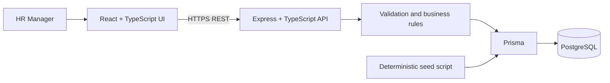

# ACME Salary Insights — Project Overview

## 1. Project at a glance

ACME Salary Insights is a web application for an HR manager to manage fictional employee compensation records and understand how the organization pays people across countries, departments, and job levels. It replaces spreadsheet-based lookup and reporting with searchable employee records, consistent salary data, and clear, currency-aware insights.

**Primary user:** HR Manager  
**Data volume:** 10,000 seeded fictional employees  
**Product focus:** Compensation record management and analysis  
**Important boundary:** This is not a payroll execution or tax-compliance system.

## 2. Product goals

- Find an employee and inspect their compensation details quickly.
- Add, update, and review employee compensation records through a web interface.
- Answer common questions such as “How many employees are in each country?” and “What is the salary distribution by department and level?”
- Handle 10,000 records with server-side search, filtering, sorting, and pagination.
- Make compensation comparisons understandable across countries and currencies.

## 3. Proposed technology

| Area | Choice | Purpose |
| --- | --- | --- |
| Web UI | React + TypeScript + Vite | Responsive single-page application |
| UI styling/components | Tailwind CSS + shadcn/ui | Consistent, accessible interface components |
| Charts | Recharts | Salary distribution and workforce summaries |
| API | Node.js + TypeScript + Express | REST endpoints and business rules |
| Database | PostgreSQL | Relational employee, compensation, and audit data |
| Data access | Prisma ORM | Typed database access, migrations, and seed workflow |
| Validation | Zod | Validate API inputs and environment configuration |
| Testing | Vitest; Supertest for API tests | Fast unit and HTTP-level tests |
| Deployment | One Render web service (API + built UI) + Neon PostgreSQL, all free tiers | Public demo with persistent relational data |

The stack uses TypeScript across the UI and API to reduce mismatches between API contracts and frontend models. PostgreSQL supports relational constraints and aggregation queries; server-side queries keep the 10,000-row dataset out of the browser.

## 4. Main user capabilities

1. **Dashboard:** employee count and salary summaries, with filters for country, department, and level.
2. **Employee directory:** search by employee ID or name; filter and paginate on the server.
3. **Employee profile:** view role, organizational details, country, local currency, salary amount, and pay frequency.
4. **Compensation updates:** edit salary details with validation and record who changed what and when.
5. **Salary insights:** show employee counts and salary distributions by compatible groups. Never combine different currencies into a single total or average without an explicit conversion policy.

## 5. High-level architecture

The browser renders screens and sends user actions to the API. The API validates input, applies salary rules, and queries PostgreSQL through Prisma. Aggregations and pagination run in the database. A deterministic seed script creates exactly 10,000 fictional employee records for repeatable development and demos.

## 6. Data model outline

- **Employee:** unique employee ID, name, department, job title, level, country, employment status, and hire date.
- **Compensation:** employee reference, amount, currency code, pay frequency, and effective date.
- **Compensation change record:** compensation reference, previous and new values, and timestamp. No user is recorded because there is no login for now.

Salary amounts are stored as exact decimal values, not floating-point numbers. Compensation history is kept separately so an update does not erase the prior value. The seed data is fictional and uses a repeatable seed strategy.

## 7. Currency and salary assumptions

Until the assessment contact clarifies otherwise, assume compensation means **base salary**, store the amount in the employee’s **local currency**, and show comparisons grouped by currency. If pay frequency is supported, convert monthly or hourly values to an annualized figure only when the required hours-per-week or pay-period assumptions are explicitly defined. Do not invent exchange rates or present a cross-currency average as meaningful.

## 8. API outline

- `GET /api/employees` — search, filter, sort, and paginate employee records.
- `GET /api/employees/:id` — return one employee and current compensation.
- `POST /api/employees` — create an employee and compensation record.
- `PATCH /api/employees/:id/compensation` — update compensation and append change history.
- `GET /api/analytics/summary` — return filtered headcount and salary summaries grouped by currency.
- `GET /api/health` — report API readiness without exposing secrets.

List endpoints use bounded page sizes and validated filter/sort parameters. API errors use a consistent response shape and appropriate HTTP status codes.

## 9. Quality, privacy, and operational decisions

- No login for now (decision 005). The demo is open and uses fictional data only. Keep secrets in deployment environment variables.
- Use fictional data only. Do not include real personal or compensation information in the repository, seed files, screenshots, or demo recording.
- Validate compensation changes on the server and preserve an audit record.
- Add database constraints and indexes for employee ID and common filters such as country, department, and level.
- Cover salary calculations, currency grouping, validation, filtering/pagination, and compensation-history behavior with deterministic tests.
- Keep deployment configuration and local setup documented so reviewers can run and inspect the app.

## 10. Deliberately out of scope

- Payroll processing, bank transfers, tax calculation, benefits, and country-specific legal compliance: these need specialized integrations and jurisdiction-specific rules.
- Login and user accounts (for now): the brief names one persona and does not ask for authentication. Adding it later is a contained change.
- Real HRIS integrations, single sign-on, multiple permission tiers, and multi-tenant administration: unnecessary for the single-persona assessment demo.
- Natural-language AI salary questions: reliable filters and explicit analytics are the core product; an AI layer would add complexity and could make sensitive compensation answers harder to validate.
- Automatic foreign-exchange conversion: no source, date policy, or target currency was specified.

These boundaries keep the submission focused on correct compensation data management, useful reporting, and maintainable engineering.

## 11. Demo path

1. Open the app as the HR manager.
2. Review the dashboard and filter by country or department.
3. Search the 10,000-employee directory and open an employee profile.
4. Update a compensation value and show its recorded change history.
5. Compare salary distributions within the same currency group and explain the currency boundary.

## 12. Decisions to confirm or document

- Whether compensation is annual base salary or another measure such as total compensation.
- Whether salary insights should use dashboards/filters or include natural-language Q&A.
- Whether cross-country comparisons should remain in local currencies or use an explicitly specified conversion source and date.

If no response is available, preserve the assumptions in Section 7 and mention them in the demo.
